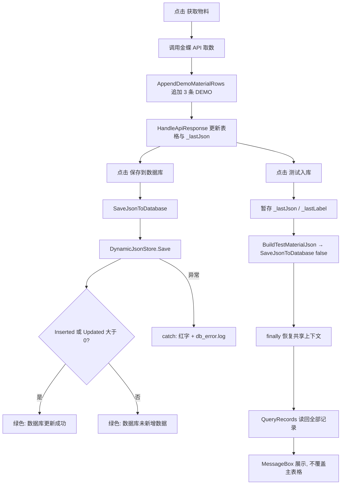

# 修改日志报表：数据库入库状态修复与测试入库闭环

> 生成时间：2026-11-21 10:09（GMT+8）
> 项目名称/用途：WindowsApplication3 —— 星辰 API 调用 WinForms 客户端（.NET Framework 4.8 / C#，含 LrGetToken 类库）
> 本次修改目标：修复数据库入库状态误报红字与“无数据更新”问题，建立“写入 → 读回”验证闭环，并让“获取物料 → 保存到数据库”流程可稳定产生新增数据
> 修改日期：2026-11-20 ~ 2026-11-21
> 目标读者：未来的我 —— 快速回顾“改了什么、用了什么方法、处理逻辑是什么、有什么可复用经验”
> 材料来源：`.workbuddy/memory/2026-11-20.md`（含 11-21 追加记录）与当前源码核对；**未提供原始 diff**

## 需要补充的信息

- 原始 diff / 提交记录：**待补充**（当前工作区无 Git 仓库，无法给出提交号）
- 实际编译与运行结果：**待确认**（本机 MSBuild / dotnet 命令被沙箱安全策略拦截，仅完成静态审查）
- `bin/Debug/db_error.log` 的真实异常内容：**待补充**
- `btnTestInsert` 的 `BackColor` 精确取值：**待补充**（材料仅记录为“黄色”）
- 数据库连接串、账号、内部 API 地址等敏感信息：**待补充**（按要求不在本文记录）

---

## 1. 变更概览

| 文件路径 | 变更类型 | 一句话说明 |
| --- | --- | --- |
| `WindowsApplication3/FrmTest.cs` | 修改 | 实现入库三态提示、异常链落盘、测试入库闭环、DEMO 数据追加与共享上下文保护 |
| `WindowsApplication3/FrmTest.Designer.cs` | 修改 | 新增 `btnTestInsert` 按钮；`chkAutoSave` 默认由勾选改为不勾选 |
| `WindowsApplication3/Data/DynamicJsonStore.cs` | 修改 | 新增 `QueryRecords`；将删除与插入拆成两次 `SaveChanges` 提交 |
| `extract_materials.py` | 删除 | 经引用核验为孤立脚本（Python 复刻金蝶 API 客户端） |
| `mock_server.py` | 删除 | 经引用核验为孤立脚本（FastAPI 模拟金蝶 API，端口 8765） |

> `materials_output.json` 经核验为非代码引用，**保留未改动**，故不列入变更表。

**整体目标**：把“入库结果”从模糊的红字/成功提示，改造为可区分“数据无变化 / 更新成功 / 真实异常”的三态反馈；同时提供一条可重复执行的闭环验证路径（获取物料 → 追加唯一 DEMO 行 → 手动保存 → 测试入库读回），并消除测试流程对主数据上下文的污染。

**整体技术手段**：以 `SaveResult.Inserted / Updated` 作为状态判据并同时设置 `Text` 与 `ForeColor`；catch 分支展开 `InnerException` 链并写入日志文件；EF Core 更新时“先删后提交、再插”分批 `SaveChanges` 规避唯一索引冲突；用毫秒时间戳构造唯一业务键制造哈希差异；用 `try/finally` 暂存恢复共享状态。

---

## 2. 逐文件分析

### 2.1 `WindowsApplication3/FrmTest.cs`

- **变更类型**：修改
- **核心方法/函数**：
  `SaveJsonToDatabase(bool)`（约 501 行）、`AppendDemoMaterialRows(string, int)`（约 614 行）、`BuildTestMaterialJson()`（约 678 行）、`BuildReadbackTable(List<ApiRecord>)`（约 708 行，保留未调用）、`btnTestInsert_Click(object, EventArgs)`（约 738 行）、`btnGetMtrl_Click(object, EventArgs)`（约 926 行）
- **处理内容**：负责 API 取数、JSON 展示与数据库入库的 UI 主窗体。修改后：成功分支按 `hasChange` 输出三态提示；catch 分支暴露真实异常；新增“测试入库”按钮的写入—读回逻辑，并保护共享的 `_lastJson / _lastLabel`；“获取物料”会追加唯一 DEMO 行以便产生可验证的新增。
- **关键处理步骤**：
  1. `btnGetMtrl_Click` 调 API 取数后调用 `AppendDemoMaterialRows(strJson, 3)`，再进入 `HandleApiResponse` 更新表格与 `_lastJson`。
  2. `btnTestInsert_Click` 暂存 `_lastJson / _lastLabel` → 临时替换为 `BuildTestMaterialJson()` → 复用 `SaveJsonToDatabase(false)` 写入 → `finally` 恢复共享状态。
  3. 用 `QueryRecords(endpoint, "", 50)` 读回该接口全部记录，结果仅在 MessageBox 展示，不覆盖主表格/文本框/标题。
- **关键代码片段**：

  三态判定与颜色重置：
  ```csharp
  bool hasChange = (r.Inserted > 0 || r.Updated > 0);
  if (hasChange) {
      lblDbStatus.Text = string.Format("数据库更新成功\n本次{0}\n累计入库{1}条", r.Summary, _dbSavedTotal);
      lblDbStatus.ForeColor = Color.DarkGreen;
  } else {
      lblDbStatus.Text = string.Format("数据库未新增数据\n本次共{0}条，数据无变化\n累计入库{1}条", r.Total, _dbSavedTotal);
      lblDbStatus.ForeColor = Color.DarkGreen;
  }
  ```

  异常链展开：
  ```csharp
  string detail = ex.Message;
  Exception innerEx = ex.InnerException;
  int innerDepth = 0;
  while (innerEx != null && innerDepth < 3) {
      detail += " -> " + innerEx.Message;
      innerEx = innerEx.InnerException;
      innerDepth++;
  }
  ```

  共享上下文保护：
  ```csharp
  string prevJson = _lastJson;
  string prevLabel = _lastLabel;
  try {
      _lastJson = BuildTestMaterialJson();
      _lastLabel = testLabel;
      saved = SaveJsonToDatabase(false);
  } finally {
      _lastJson = prevJson;
      _lastLabel = prevLabel;
  }
  ```

  唯一业务键构造（示意，原始变量名待确认）：
  ```csharp
  // DEMO-<yyyyMMddHHmmssfff>-<i>：毫秒时间戳保证每次唯一
  // → 哈希不同 → DynamicJsonStore.Save 判定为 Inserted
  ```

- **使用到的技术/API/库/设计模式**：WinForms 控件状态更新（`Label.Text` + `ForeColor`）、`MessageBox`、`Cursor.WaitCursor`、`Newtonsoft.Json` 风格 JSON 解析、`EndpointMap.ResolvePath`、`try/finally` 资源/状态恢复模式、三态状态机
- **影响范围**：被 `btnTestInsert_Click`、`btnGetMtrl_Click` 及“保存到数据库”按钮调用；影响入库提示文案与颜色、`lblDbStatus` 显示、`bin/Debug/db_error.log`、`_lastJson / _lastLabel` 的取值，进而影响后续所有保存操作的数据源
- **不确定点**：
  - `HandleApiResponse` 的完整调用参数：**待确认**（仅确认调用顺序）
  - `AppendDemoMaterialRows` 的完整实现与变量名：**待确认**（材料仅记录 id/number 规则与容错解析）
  - `BuildReadbackTable` 保留未调用，是否后续删除：**待确认**

### 2.2 `WindowsApplication3/FrmTest.Designer.cs`

- **变更类型**：修改
- **核心方法/函数/组件**：`btnTestInsert`（新增 Button 控件）、`chkAutoSave`（CheckBox 默认值调整）
- **处理内容**：窗体设计器代码。新增“测试入库”按钮并完成声明、初始化、属性赋值、`Controls.Add` 四处登记；将自动保存复选框默认关闭，使用户必须手动点击“保存到数据库”。
- **关键处理步骤**：
  1. 新增 `btnTestInsert`：`Text = "测试入库"`，`Location = (12, 440)`，`TabIndex = 32`，背景色黄色（精确值待补充），四处登记齐全。
  2. `chkAutoSave.Checked` 由 `true` → `false`，`CheckState` 由 `Checked` → `Unchecked`（约 361-362 行）。
  3. 保存动作改由用户手动触发，避免“获取物料”时已自动入库导致再点保存只得到 Unchanged。
- **关键代码片段**：
  ```csharp
  this.chkAutoSave.Checked = false;
  this.chkAutoSave.CheckState = CheckState.Unchecked;
  ```
  ```csharp
  this.btnTestInsert.Text = "测试入库";
  this.btnTestInsert.Location = new System.Drawing.Point(12, 440);
  this.btnTestInsert.TabIndex = 32;
  // BackColor：黄色（精确取值待补充）
  ```
- **使用到的技术/API/库/设计模式**：WinForms 设计器生成代码、控件 `TabIndex` 顺序管理、`System.Drawing.Point / Color`
- **影响范围**：`FrmTest` 窗体布局与 Tab 顺序；`chkAutoSave` 默认值影响所有取数按钮的入库时机；“保存到数据库”从被动变为主动触发
- **不确定点**：`btnTestInsert.BackColor` 精确值、控件变量声明的完整代码：**待补充**

### 2.3 `WindowsApplication3/Data/DynamicJsonStore.cs`

- **变更类型**：修改
- **核心方法/函数/类**：`Save(string, string, string)`（约 51 行）、`AddFields(XcApiDbContext, ApiRecord, List<FlatField>)`（约 200 行）、`QueryRecords(string, string, int)`（约 310 行，新增）、`SaveResult`
- **处理内容**：动态 JSON → 关系表入库核心。`Save` 的更新分支改为“先删旧字段并提交、再插新字段”；新增 `QueryRecords` 提供真实数据库读回能力。
- **关键处理步骤**：
  1. `Save` 比对数据差异，返回 `SaveResult.Total / Inserted / Updated / Unchanged / Summary`。
  2. 更新时 `RemoveRange(旧字段)` 后先 `db.SaveChanges()`，再 `AddFields` 插入同名新字段，避免 EF Core 同批次对相同 `(RecordId, FieldName)` 先 INSERT 后 DELETE 违反唯一索引 `ux_api_record_field_record_field`。
  3. `QueryRecords` 按 Endpoint 精确匹配 + `BizKey.Contains` 过滤，`LastSyncTime` 倒序 `Take(topN)`，内部 `EnsureCreated()` 兜底。
- **关键代码片段**：
  ```csharp
  public List<ApiRecord> QueryRecords(string endpoint, string bizKeyContains, int topN)
  // Endpoint 精确匹配 + BizKey.Contains 过滤 → LastSyncTime 倒序 → Take(topN)
  // 内部 EnsureCreated() 兜底
  ```
  ```csharp
  db.ApiRecordFields.RemoveRange(oldFields);
  db.SaveChanges();            // 先提交删除
  AddFields(db, rec, fields);  // 再插入同名新字段（变量名示意，待确认）
  ```
- **使用到的技术/API/库/设计模式**：EF Core 3.1 + SQL Server、`DbContext.SaveChanges`、`RemoveRange`、`EnsureCreated`、`Take` 分页、唯一索引约束、仓储/服务封装模式
- **影响范围**：被 `FrmTest.SaveJsonToDatabase`、`btnTestInsert_Click` 调用；影响 `api_record / api_record_field / api_record_change / api_sync_log` 四张表的写入与读回，以及所有入库状态判定
- **不确定点**：`EnsureCreated()` 不会升级已存在的旧库，`XingChenDb` 是否缺列：**待确认**；`QueryRecords` 的 EF Core 3.1 SQL 翻译在实际 SQL Server 上的行为：**待确认**

### 2.4 `extract_materials.py`（已删除）

- **变更类型**：删除
- **核心方法/函数**：Python 复刻的金蝶 API 客户端（材料未给出具体函数名：**待补充**）
- **处理内容**：连接 mock 服务抓取物料并输出 `materials_output.json`。经核验 C# 项目零引用、不参与编译运行后安全删除；其输出文件保留。
- **关键处理步骤**：
  1. 全项目检索确认无任何 C# 引用。
  2. 确认不参与编译与运行。
  3. 删除脚本，保留 `materials_output.json`。
- **关键代码片段**：无（已删除）
- **使用到的技术/方法**：Python、依赖/引用静态核验
- **影响范围**：仅影响独立调试流程；主程序无影响
- **不确定点**：是否存在工作区外的调用方：**待确认**

### 2.5 `mock_server.py`（已删除）

- **变更类型**：删除
- **核心方法/函数**：FastAPI 模拟金蝶 API 服务，监听端口 8765（具体路由名：**待补充**）
- **处理内容**：为 `extract_materials.py` 提供 mock 接口。经同样的引用核验后删除。
- **关键处理步骤**：同 2.4；核验 → 确认无引用 → 删除。
- **关键代码片段**：无（已删除）
- **使用到的技术/API/库**：FastAPI、Python、HTTP 8765 端口
- **影响范围**：仅影响本地 mock 调试；主程序无影响
- **不确定点**：端口 8765 是否被其他进程/脚本依赖：**待确认**

---

## 3. 方法与技术清单

| 方法/函数/类 | 所在文件 | 作用 | 是否可复用 | 备注 |
| --- | --- | --- | --- | --- |
| `SaveJsonToDatabase(bool showDialog)` | `WindowsApplication3/FrmTest.cs:501` | 调用 `Save` 入库；三态提示；catch 展开异常链并写 `db_error.log` | 是 | `showDialog=false` 供测试入库静默调用 |
| `Save(string endpoint, string endpointName, string json)` | `WindowsApplication3/Data/DynamicJsonStore.cs:51` | 入库核心，返回 `SaveResult` | 是 | 更新分支已做分批提交修复 |
| `AddFields(XcApiDbContext, ApiRecord, List<FlatField>)` | `WindowsApplication3/Data/DynamicJsonStore.cs:200` | 写入字段明细 | 是 | 需在删除提交后调用 |
| `QueryRecords(string endpoint, string bizKeyContains, int topN)` | `WindowsApplication3/Data/DynamicJsonStore.cs:310` | 按 Endpoint + BizKey 读回记录 | 是 | 本次新增 |
| `PickBizKey(JObject row, string hash)` | `WindowsApplication3/Data/JsonFlattener.cs:211` | 提取业务键，优先 `id` | 是 | 决定新增/更新判定与读回命中（未修改） |
| `AppendDemoMaterialRows(string json, int count)` | `WindowsApplication3/FrmTest.cs:614` | 追加唯一时间戳 DEMO 行，制造可验证的新增 | 否 | 验证专用，非生产逻辑 |
| `BuildTestMaterialJson()` | `WindowsApplication3/FrmTest.cs:678` | 构造 `TEST-ITEM-001` 测试数据 | 否 | 验证专用 |
| `BuildReadbackTable(List<ApiRecord>)` | `WindowsApplication3/FrmTest.cs:708` | 读回记录转 `DataTable` | 待确认 | 当前保留未调用 |
| `btnTestInsert_Click(object, EventArgs)` | `WindowsApplication3/FrmTest.cs:738` | 写入 → 读回 → 弹窗展示；`try/finally` 恢复共享上下文 | 是（模式） | 本次修复重点 |
| `btnGetMtrl_Click(object, EventArgs)` | `WindowsApplication3/FrmTest.cs:926` | API 取数后追加 DEMO 行 | 否 | 业务入口 |
| `chkAutoSave` / `btnTestInsert` | `WindowsApplication3/FrmTest.Designer.cs:361-362` 等 | 默认关闭自动保存 / 新增测试按钮 | 部分 | UI 配置 |

---

## 4. 处理流程总结



**调用链简述**：UI 取数 → JSON 入 `_lastJson` → `SaveJsonToDatabase` → `DynamicJsonStore.Save` → 三态 UI 反馈；测试入库在链条外临时切换数据、复用同一 `Save` 链路，读回后恢复现场。

---

## 5. 学习总结

### 本次新学到的知识点

- **状态提示必须“文本 + 颜色”成对设置**：只改 `Text` 不改 `ForeColor`，历史失败的红字会残留，造成“数据一致却显示入库失败”的假象。
- **异常要展开内层链**：`ex.Message` 常不含真实原因；逐层拼接 `InnerException` 并在自动入库时写文件，才能定位 SQL 层错误。
- **EF Core 同批次 UPDATE 的陷阱**：对相同唯一键先 INSERT 后 DELETE 会撞唯一索引；拆成两次 `SaveChanges` 是简单有效的规避方式。
- **哈希去重需要可控的差异输入**：稳定 API 数据永远 Unchanged；用毫秒时间戳构造唯一 `id/BizKey` 才能验证 Inserted 路径。
- **EnsureCreated 不升级已有库**：表结构过时可能是入库失败的真实根因，异常中的 `column / 字段` 关键词可作为提示触发点。

### 可复用的代码模式/设计思路

- **三态状态机**：以业务结果（`Inserted / Updated`）而非布尔成功/失败驱动 UI，文案与颜色统一管理。
- **`try/finally` 现场恢复**：测试/临时流程修改共享状态前先暂存，结束无条件恢复，避免污染主流程。
- **闭环验证按钮**：在同一 UI 内实现“写入 → 读回 → 展示”，比外部脚本更贴近真实业务链路。
- **引用核验后删除**：删除可疑文件前先全项目搜索引用、确认不参与编译，再执行删除并保留数据文件。

### 踩坑与注意事项

- 用户看到的可能是**旧 exe**：编译产物时间戳早于源码时，任何源码修改都“无效”；必须先重新生成解决方案。
- `chkAutoSave` 默认开启会让手动保存永远“无数据更新”——排查此类问题先检查自动流程是否已抢先执行。
- 测试按钮覆盖 `_lastJson` 会导致后续保存只剩测试数据；这是典型的共享可变状态污染。
- 本机编译被沙箱拦截时，只能做静态审查；交付时必须明确标注未经编译验证。

### 风险点和待办事项

- **待确认**：实际编译与运行结果、`db_error.log` 内容、SQL Server 上 EF Core 3.1 的 SQL 翻译行为、`XingChenDb` 是否缺列。
- **风险**：`AppendDemoMaterialRows` 每次取数都会新增 3 条 DEMO 数据，重复操作持续累积，仅适用于验证环境。
- **风险**：`BuildReadbackTable()` 未被调用，属死代码；后续可决定是否清理。
- **风险**：删除的两个 `.py` 脚本若在工作区外被调用，影响范围**待确认**。

---

## 6. 后续复习清单

1. 复习 `FrmTest.cs` 中 `SaveJsonToDatabase` 的**三态判据**（`hasChange`）与 `ForeColor` 显式重置，确认红字残留问题不再复现。
2. 复习 catch 分支的**异常链展开 + `db_error.log` 落盘**，记住自动入库时 UI 不可见错误的排查入口。
3. 复习 `DynamicJsonStore.cs` 中**两次 `SaveChanges` 的顺序**，理解唯一索引 `ux_api_record_field_record_field` 冲突的成因。
4. 复习 `btnTestInsert_Click` 的 **`try/finally` 现场恢复**模式，以及“读回不改主表格”的边界。
5. 复习 `AppendDemoMaterialRows` 的**毫秒时间戳唯一键**技巧，及其“仅验证用”的适用边界。
6. 复习 `chkAutoSave` 默认值改动，理解“自动保存抢先导致 Unchanged”这一反直觉现象。
7. 重新生成解决方案并实际跑一遍**五步验证流程**，补齐“待确认/待补充”项，尤其是 `db_error.log` 与 SQL 翻译行为。
